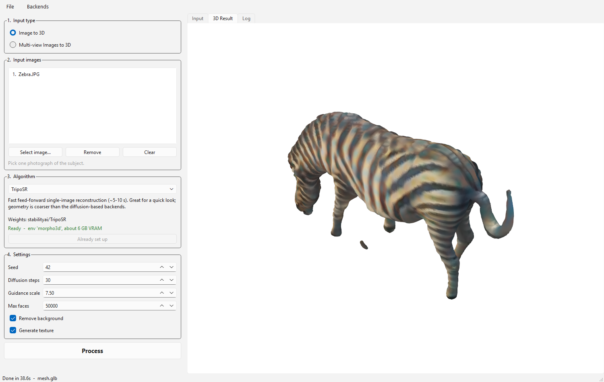
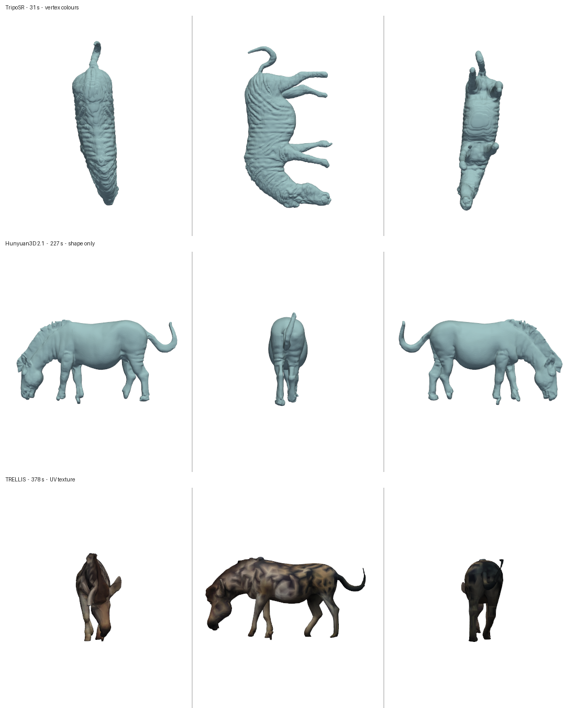

# morpho3D

A desktop GUI for turning photographs into 3D meshes, with several
state-of-the-art image-to-3D models behind one interface.

Pick an input type — **one image**, or **several views of one object** — choose a
generator, press **Process**. Everything runs locally on your own GPU; no
service calls, no API keys.



---

## Contents

- [Why](#why)
- [Features](#features)
- [Requirements](#requirements)
- [Installation](#installation)
- [Usage](#usage)
- [Backends](#backends)
- [Architecture](#architecture)
- [Native build dependencies](#native-build-dependencies)
- [Troubleshooting](#troubleshooting)
- [Adding a backend](#adding-a-backend)
- [Credits and licensing](#credits-and-licensing)

---

## Why

The open image-to-3D models are excellent but awkward to use side by side. Each
ships its own repo, its own Gradio demo, and a dependency stack that actively
conflicts with its neighbours. Comparing two of them on your own photograph
usually means two environments, two sets of instructions, and two different
output conventions.

morpho3D puts them behind a single window and a single **Process** button, and
keeps the environment problem out of your way.

## Features

- **Two input modes** — single image, or multiple views of one object
- **Nine backends** behind one interface, filtered automatically to the ones
  that accept your chosen input type
- **One-click setup** — each backend creates its own environment, clones its
  source and installs its dependencies on demand
- **Runs locally** on your GPU; model weights are downloaded once and shared
  between backends
- **Live log and 3D preview**, with results written as `.glb`
- Background removal, seed, step count, guidance and face budget exposed in the UI
- A CLI (`tools_cli.py`) covering the same functionality for scripted runs

```
1. Input type   ->  Image to 3D  |  Multi-view Images to 3D
2. Input images ->  file picker (one file, or many + drag to reorder)
3. Algorithm    ->  filtered to backends that accept that input type
4. Settings     ->  seed / steps / guidance / max faces / background / texture
   [ Process ]  ->  runs on the GPU, streams a log, shows the mesh
```

Results land in `outputs/<timestamp>_<backend>/mesh.glb`.

## Requirements

| | |
| --- | --- |
| OS | Windows 10/11 (developed and tested here). Linux should work; the provisioner is cross-platform but unverified there. |
| GPU | NVIDIA, 8 GB VRAM minimum. 12–16 GB recommended — TRELLIS and Hunyuan3D are the hungry ones. |
| Python | 3.11 for the main environment (backends pin their own) |
| conda | Miniconda or Anaconda. Does not need to be on `PATH`; it is discovered automatically. |
| git | Required, for fetching backend sources |
| Disk | ~10 GB for the app and one backend; **50 GB+** if you provision everything |

Backends that compile CUDA extensions additionally need a C++ compiler — see
[Native build dependencies](#native-build-dependencies). TripoSR does not, so
you can get a first result with no build toolchain at all.

## Installation

```bash
git clone https://github.com/<your-user>/morpho3D.git
cd morpho3D

conda create -n morpho3d python=3.11 -y
conda activate morpho3d

# PyTorch first, matched to your CUDA version
pip install torch==2.5.1 torchvision==0.20.1 torchaudio==2.5.1 \
    --index-url https://download.pytorch.org/whl/cu124

pip install -r requirements.txt
```

Then check the install and launch:

```bash
python tools_cli.py doctor     # GPU, compiler, per-backend readiness
python run_gui.py
```

TripoSR works immediately. Every other backend shows `[not set up]` until you
select it and press **Set up this backend**, which provisions it in the
background — nothing heavyweight is installed until you ask for it.

> The conda environment is named `morpho3d` (lowercase) while the repository is
> `morpho3D`. That is deliberate: environment and Python package names stay
> lowercase per convention, which also avoids case-sensitivity surprises
> between Windows and Linux.

## Usage

### GUI

```bash
python run_gui.py
```

For multi-view input, the **row order is the view order**. Backends that expect
named viewpoints read them as front, back, left, right — drag rows to reorder.

### CLI

```bash
python tools_cli.py doctor                      # what is installed and ready
python tools_cli.py setup trellis               # provision one backend (or `all`)
python tools_cli.py run triposr photo.jpg       # single image
python tools_cli.py run trellis f.png b.png l.png r.png   # multi-view
python -m pytest tests -q                       # 46 tests, no GPU required
```

## Backends



### Single image → 3D

| Backend | Weights | Status |
| --- | --- | --- |
| **TripoSR** | `stabilityai/TripoSR` | ✅ Verified — fast, no compiler needed |
| **Hunyuan3D 2.1** | `tencent/Hunyuan3D-2.1` | ✅ Verified — best geometry of the three |
| **TRELLIS** | `microsoft/TRELLIS-image-large` | ✅ Verified — UV texture + gaussian splat |
| **Stable Fast 3D** | `stabilityai/stable-fast-3d` | ⚙️ Wired up — gated weights, accept the licence and log in |
| **SAM 3D Objects** | `facebook/sam-3d-objects` | ⚙️ Wired up — needs PyTorch3D and a manual checkpoint |
| **Unique3D** | `AiuniAI/Unique3D` | ⚙️ Wired up |

### Multi-view → 3D

| Backend | Status |
| --- | --- |
| **TRELLIS** | ✅ Verified — native multi-image conditioning; the strongest option |
| **Hunyuan3D 2mv** | ⚙️ Provisioned — expects front / back / left / right in row order |
| **Unique3D** | ⚙️ Wired up — uses your views instead of generating them |
| **Wonder3D** | ⚙️ Wired up — six-view cross-domain diffusion + NeuS |
| **SyncDreamer** | ⚙️ Wired up — 16 synchronised views + NeuS; slowest by far |

Backends supporting both modes will generate the missing views themselves when
given a single image.

**✅ Verified** means run end to end on this hardware with the output inspected.
**⚙️ Wired up** means the worker is written against the project's documented
entry points and provisioning is defined, but it has not been executed here.

### Measured results

On the bundled `Zebra.JPG`, RTX 3080 Ti (16 GB):

| | TripoSR | Hunyuan3D 2.1 | TRELLIS |
| --- | --- | --- | --- |
| time | 31 s | 227 s | 378 s |
| vertices / faces | 31,370 / 62,736 | 25,002 / 50,000 | 13,489 / 22,590 |
| watertight | yes | yes | no |
| components | 2 | **1** | 45 after cleanup |
| degenerate faces | 5 | **0** | 0 |
| colour | vertex colours | shape only | **UV texture** |

Reach for TripoSR while iterating and Hunyuan3D when the mesh matters. TRELLIS
is the one to use for multi-view, and the only one producing a real UV texture
plus a gaussian splat.

Multi-view TRELLIS on four rendered views of the same object finished in **60 s**
against 378 s for a single photograph — clean cut-outs are far less work — with a
visibly sharper texture.

### A note on Hunyuan3D 2.5

**2.5 has no public weights.** Tencent published the 2.5 technical report in
June 2025 but released only a hosted API; the open-weight line stops at **2.1**,
which is what this project runs. If 2.5 weights ever appear, adding them is one
new entry in `morpho3d/backends/hunyuan3d.py`.

## Architecture

### One environment per backend

These nine generators pin mutually exclusive stacks. Unique3D wants
`torch 2.1 / diffusers 0.27`; Wonder3D and SyncDreamer want
`pytorch-lightning 1.x / transformers 4.30`; TRELLIS and Hunyuan3D want
`torch 2.4+` with newer `diffusers`. Resolved into a single environment, several
of them simply stop working.

So each stack gets its own environment, and the GUI hides the difference:

| environment | holds |
| --- | --- |
| `morpho3d` | GUI, orchestrator, TripoSR |
| `morpho3d-trellis` | TRELLIS |
| `morpho3d-hunyuan3d` | Hunyuan3D 2.1 and 2mv |
| `morpho3d-sf3d` | Stable Fast 3D |
| `morpho3d-sam3d` | SAM 3D Objects |
| `morpho3d-unique3d` | Unique3D |
| `morpho3d-wonder3d` | Wonder3D |
| `morpho3d-syncdreamer` | SyncDreamer |

A backend runs as a subprocess in its own environment, communicating over a
small JSON contract (`morpho3d/runner/subprocess_runner.py`): the orchestrator
writes `job.json`, the worker streams progress on stdout and writes
`result.json`. Weights are shared through `cache/huggingface`, so switching
backends never re-downloads a model another one already has.

### Layout

```
run_gui.py                      GUI entry point
tools_cli.py                    CLI entry point
morpho3d/
  config.py                     paths, conda/CUDA/MSVC discovery, shared cache
  backends/
    base.py                     Backend / JobSpec / Availability contract
    registry.py                 the catalogue
    triposr.py trellis.py hunyuan3d.py sf3d.py multiview.py
  runner/
    subprocess_runner.py        cross-environment execution + log streaming
    scripts/*_worker.py         one worker per backend
    shims/                      lightweight stand-ins for heavy dependencies
  setup/provision.py            environment creation, cloning, installation
  gui/                          main_window.py, widgets.py, worker.py
tests/                          46 tests, no GPU required
vendor/                         cloned backend sources (gitignored)
cache/                          shared model weights (gitignored)
outputs/<timestamp>_<backend>/  results (gitignored)
```

## Native build dependencies

Most backends compile CUDA/C++ extensions at install time:

| Extension | Needed by |
| --- | --- |
| `torchmcubes` | TripoSR — **worked around**, see below |
| `pytorch3d` | Unique3D, SAM 3D |
| `nvdiffrast` | TRELLIS, Unique3D, Wonder3D |
| `diff-gaussian-rasterization` | TRELLIS (required — the GLB texture bake uses it) |
| `custom_rasterizer`, `DifferentiableRenderer` | Hunyuan3D texture stage |
| `texture_baker`, `uv_unwrapper` | Stable Fast 3D |

These need a C++ compiler. On Windows:

```powershell
winget install Microsoft.VisualStudio.2022.BuildTools `
  --override "--wait --quiet --add Microsoft.VisualStudio.Workload.VCTools --includeRecommended"
```

They also need **`nvcc`**, which the PyTorch wheels do not ship — they bundle the
CUDA runtime but not the compiler. Provisioning installs a matching CUDA toolkit
into each backend's own environment, so it always matches that environment's
torch build and nothing is installed system-wide.

**TripoSR needs no compiler at all.** `morpho3d/runner/shims/mcubes_shim.py`
substitutes PyMCubes (a pure wheel) for the uncompilable `torchmcubes`, matching
its axis convention so meshes come out correctly oriented. A similar shim
supplies the single function TRELLIS needs from kaolin, avoiding a multi-gigabyte
dependency. Both shims are covered by tests.

## Troubleshooting

A CUDA extension builds only when **all four** of these hold, and each failure
points somewhere other than the real cause:

| Missing | Symptom |
| --- | --- |
| MSVC | `Microsoft Visual C++ 14.0 or greater is required` |
| `CUDA_HOME` | `CUDA_HOME environment variable is not set` |
| `--no-build-isolation` | `ERROR! Cannot compile ... ensure you have PyTorch installed` |
| correct `CUDA_HOME` **path** | `[WinError 2] The system cannot find the file specified` |

That last one is easy to inflict by hand: conda puts `nvcc` at
`<env>/bin/nvcc.exe`, not `<env>/Library/bin`. Use `config.build_env(env_name)`
rather than setting the variables yourself.

**conda installs the wrong nvcc.** `conda install cuda-toolkit=12.4` pins only
the metapackage and the solver may pull `cuda-nvcc-13.3` alongside it, which
cannot build against a cu124 torch. Provisioning pins `cuda-version` as well and
then verifies by parsing `nvcc --version`.

**A model fails to load with a wall of missing state-dict keys.**
`transformers` is pinned below 5.0 throughout; v5 refactored the ViT module
layout, breaking the DINO checkpoints these models ship with.

**The 3D viewer is blank or Qt crashes on startup.** `vtk` is pinned to 9.3.1 —
the 9.7 wheel is missing `vtkRenderingFreeType`.

**`git clone` fails with "Filename too long" on Windows.** Handled: the
provisioner clones with `-c core.longpaths=true` per command, leaving your global
git config untouched.

**Backend requirements.** The install plans are deliberately *not* each repo's
`requirements.txt`. Hunyuan3D's, for example, pulls `gradio`, `bpy`, `deepspeed`
and `basicsr`; none are needed to generate a shape, and `basicsr` does not build
against current torchvision. Each plan installs only what the code path actually
imports.

## Adding a backend

Subclass `Backend`, declare `modes`, `env_suffix`, `repo` and `install_plan()`,
write a worker script that reads `job.json` and writes `result.json`, and add it
to `ALL_BACKENDS`. The GUI picks it up with no further changes.

## Known limitations

- Hunyuan3D's **PBR texture stage** is separate from its shape stage and needs
  `custom_rasterizer` + `DifferentiableRenderer` compiled, plus a RealESRGAN
  checkpoint and `bpy`. The worker catches its failure and keeps the untextured
  shape rather than losing the run.
- TripoSR output can contain a small disconnected fragment. That is the model,
  not the pipeline.
- Linux is untested. Nothing in the design is Windows-specific, but the CUDA and
  compiler discovery paths have only been exercised on Windows.

## Credits and licensing

This project is a front-end. All reconstruction is done by the work below —
please cite and respect the licence of whichever backend you use.

| Project | Authors | Licence |
| --- | --- | --- |
| [TripoSR](https://github.com/VAST-AI-Research/TripoSR) | Tripo AI & Stability AI | MIT |
| [TRELLIS](https://github.com/microsoft/TRELLIS) | Microsoft | MIT |
| [Hunyuan3D 2.1](https://github.com/Tencent-Hunyuan/Hunyuan3D-2.1) | Tencent | Tencent Hunyuan 3D 2.1 Community License |
| [Hunyuan3D 2](https://github.com/Tencent-Hunyuan/Hunyuan3D-2) | Tencent | Tencent Hunyuan 3D 2.0 Community License |
| [Stable Fast 3D](https://github.com/Stability-AI/stable-fast-3d) | Stability AI | Stability Community License (gated weights) |
| [SAM 3D Objects](https://github.com/facebookresearch/sam-3d-objects) | Meta AI | SAM Licence |
| [Unique3D](https://github.com/AiuniAI/Unique3D) | AiuniAI | MIT |
| [Wonder3D](https://github.com/xxlong0/Wonder3D) | Xiaoxiao Long et al. | see upstream |
| [SyncDreamer](https://github.com/liuyuan-pal/SyncDreamer) | Yuan Liu et al. | see upstream |
| [nvdiffrast](https://github.com/NVlabs/nvdiffrast) | NVIDIA | NVIDIA Source Code License |
| [mip-splatting](https://github.com/autonomousvision/mip-splatting) | Autonomous Vision Group | Gaussian-Splatting License |

> ⚠️ **Not every backend is free for commercial use.** In particular
> `diff-gaussian-rasterization`, which TRELLIS requires, is distributed under the
> Gaussian-Splatting License and is **research / non-commercial only**. The
> Tencent and Meta licences carry their own conditions, and Stable Fast 3D's
> weights are gated behind licence acceptance. Check the terms for the specific
> backend you intend to use before relying on its output.

No model weights are redistributed here; each backend downloads its own from the
original source on first run.
